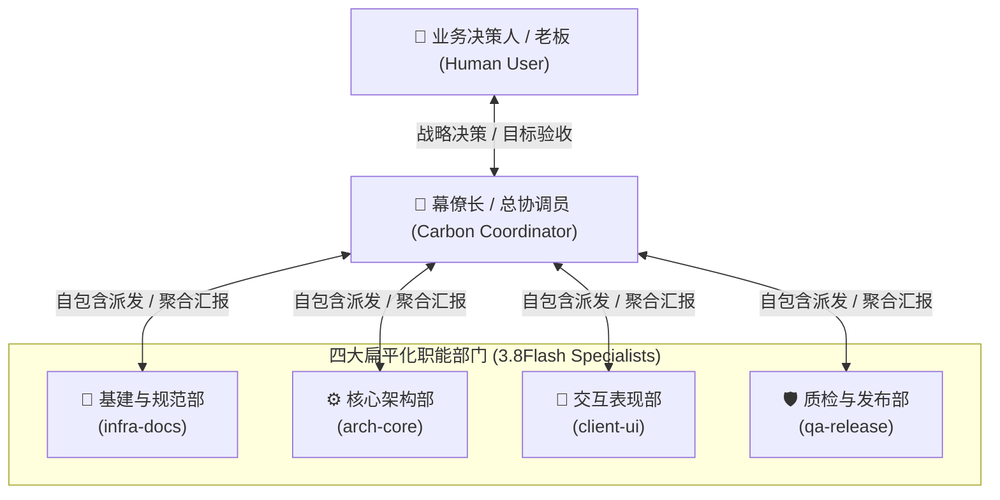

# AI Agent 协作宪章与工程治理总纲 (AGENTS.md)

> **适用范围**：本协议为《深空当铺》（*Probably Stolen*，Steam AppID: `4348910`）原生核心模组 **「可能是按键统一优化 / Probably Unified Hotkeys」**（模组 ID: `probably_unified_hotkeys`，创意工坊 ID: `3837828444`，目标版本 `v1.5.0`）工程协作的最高行为宪章。所有进入本工作区的智能代理（AI Agents）必须无条件服从并严格执行本文件包含的所有组织拓扑、红线铁律与流程门禁。

---

## 第一章 组织拓扑与协作宪章

本项目采用 **“老板（Human User）— 幕僚长（Carbon Coordinator）— 四大扁平化职能部门（3.8Flash Specialists）”** 的扁平化协作拓扑。



### 1.1 拓扑铁律与职权边界
1. **单层星型扁平拓扑（绝对禁止套娃派生）**：
   - 所有的职能代理（Specialists）均直接由幕僚长（Carbon）单层派发与回收。
   - **严禁子代理再派生子代理**：各职能专家严禁在自身任务中调用 `swarm add` 或类似工具衍生孙代代理；若任务过载，必须由幕僚长按阶段拆分为离散批次调度。
2. **零历史自包含派发（Self-Contained Task Brief）**：
   - 职能代理启动时默认处于无历史上下文（Clean-slate）状态。幕僚长向职能代理下发的 Brief 必须自包含完成任务所需的全部输入：明确的工作区路径、管辖文件清单、依赖前置、技术规范参考源以及验收完成标准。
3. **上下文防污染与汇报机制**：
   - 职能代理向留言板或幕僚长呈报进展时，执行**只读结构化摘要汇报**（禁止冗余复述完整文件、禁止闲聊打招呼、禁止无效确认回执）。
   - 跨阶段状态流转必须沉淀于 `docs/handoff/` 交接三件套（`map.md`、`risk.md`、`decision.md`），确保上下文干净、可追溯且零丢失。

---

## 第二章 工程红线与安全铁律（最高准则）

### 2.1 工作区管辖与防碰撞红线
1. **唯一合法写入工作区**：`D:\workspace\probably_unified_hotkeys_re` 为当前版本重构的唯一合法写入区。
2. **永久绝对禁写区（最高物理红线）**：
   - `D:\workspace\probably_unified_hotkeys`（v1 原版仓）
   - `D:\workspace\probably_unified_hotkeys_v2`（v2 规划仓）
   - **上述两个历史目录永久处于只读模式**：严禁执行任何写入、修改、重命名、移动或删除命令！任何工具调用若命中上述两路径的写操作，直接判定为严重工程事故并立即阻断。
3. **模块目录管辖边界（防并发冲突）**：
   - 各职能部门代理严格在分配的文件管辖范围内作业，严禁擅自修改属于其他部门的文件。
   - 任何代理不得触碰未经授权的基建配置文件（如 `.editorconfig`、`Directory.Build.*`、`.sln`、`.github/workflows/` 等）。

### 2.2 反垃圾化与高质量交付铁律
1. **严禁生成一次性临时垃圾脚本**：
   - 严禁手写生成 `temp.ps1`、`test.py`、`gen_doc.sh` 等一次性脚本来生成或修改代码及文档；所有文件必须通过标准文件读写工具（`write_file` / `edit_file`）直接生成与落盘。
2. **零占位代码铁律（Zero-TODO Policy）**：
   - 代码与文档中严禁遗留 `TODO`、`FIXME`、`// 待实现`、`/* placeholder */` 等任何敷衍性占位符；交付物必须是功能完备、逻辑闭环且经得起静态检查的成品。

### 2.3 对外文案去 AI 化与规范书面语铁律
1. **核心红线范围**：
   - 所有面向玩家、用户与社区的对外文案交付物（包括但不限于根目录 `README.md`、创意工坊 VDF 描述、游戏内 `manifest.xml`、`CHANGELOG.md` 及 GitHub Release Notes），严禁出现中文维基百科 `WP:AISIGNS`（《AI生成文的特征》）所列之机器腔、空洞八股与模板化格式。
2. **强制关联资产与自检规程**：
   - **工程规范手册**：撰写与评审文案前必须严格学习并执行 [docs/ANTI_AI_WRITING_GUIDE.md](file:///d:/Workspace/probably_unified_hotkeys_re/docs/ANTI_AI_WRITING_GUIDE.md)（《对外文案去 AI 化工程参考手册》）。
   - **标准自检技能**：在生成或审查文案时，必须主动激活并执行工作区技能 [.agents/skills/anti-ai-writing/SKILL.md](file:///d:/Workspace/probably_unified_hotkeys_re/.agents/skills/anti-ai-writing/SKILL.md) 规定的 8 步执行清单。
3. **关键门禁指标**：
   - **零禁词与零生造缩略词红线**：严禁出现夸张虚浮程度副词（彻底、全面、深度、丝滑、极致等）与互联网包装黑话（赋能、闭环、一站式等）；**统一采用规范现代汉语书面语，严禁生造缩略词或夹杂内部口语黑话**（严禁使用「切场、退游、退页面、开窗、换机、秒开、筛出」等生造词，必须使用「返回主菜单、退出游戏、退出页面、打开页面、更换设备、缩短加载时间、筛选出」等标准表达）。
   - **零否定平行与对称强迫**：严禁滥用「不是…而是…」、「不仅…更是…」等虚假对比句，章节标题严禁机械套用「XX与YY」对称模板。
   - **拒绝括号与加粗列表模板**：严禁正文及列表中频繁插塞「（如…）」等冗余举例括号；严禁列表清一色套用 `**加粗词：** 解释句` 机械格式。
   - **三端文案联动同步与同级原则**：修改任一端对外文案（工坊 `.vdf`、GitHub `README.md`、游戏内 `manifest.xml`）的用词规范时，**必须同步排查并修正其余两端的同类表述**，严禁顾此失彼；提及组合键与鼠标右键/侧键时，必须同级并列提及空键解绑；严禁重新引入已弃用的「多吉改键器」及已删减的冗余 FAQ。
   - **人机交付分层**：向人类审阅者呈交预览时必须提供排版干净的纯文本或 Markdown 净版文档，严禁直接倾倒 `[hr]`、`[b]`、`[list]` 等底层机器 BBCode 标记。
   - **违规退回机制**：凡初审命中明显 AI 腔或生造缩略词者，直接判定为交付不合格并不予合并，必须就地平实重写。

---

## 第三章 游戏底层约束与零权限门禁

### 3.1 官方原生模组 SDK 契约
1. **非 BepInEx 环境**：
   - 《深空当铺》内置官方原生模组系统（`IMod`、`LoadedMod`、`ModLoader`，运行于 Unity 2021.3.45f2 Mono BleedingEdge 环境）。
   - 严禁假定或引入 BepInEx 依赖链，所有生命周期挂载与选项扩展均基于游戏官方提供的 `IMod` 接口与 Harmony 2.4.2。
2. **官方 2026-12-10 零权限生死线（Zero-Permission Standard）**：
   - 自 2026-12-10 起，未获官方白名单（`trust-list.json`）认证而声明 `files` 或 `network` 能力的模组将被官方加载器强行阻断（`Refused=True`）。
   - **默认发布包必须保持 0 权限纯净模式**：`src/ProbablyUnifiedHotkeys/ProbablyUnifiedHotkeys.csproj` 默认注入 `DisableDllKeyProbe=true`（定义 `DISABLE_DLL_KEY_PROBE`），`manifest.xml` 声明 `<Capabilities />` 为空，确保官方静态审计达成 **`0 Capabilities / 0 HardFlags / 0 Deprecated / Refused=False`**。
3. **零外部无命名空间反射红线**：
   - 严禁对无命名空间的外部第三方类（如 `probablystolen.trainer`、`RealTimeClock` 等）使用 `AccessTools` / `Type.GetType` 动态打补丁，否则会被官方扫描器识别为 `reflection-external` 并触发废弃拦截。此类模组统一通过官方只读数据通道接入。

### 3.2 原生 UI 尺寸保护与局部表现边界
1. **禁止擅改原版控件外部物理尺寸**：
   - 未经老板明确授权，严禁更改游戏原版 UI 控件的外部宽高尺寸（例如按键绑定按钮外框宽度严格保持原版 `160f`，长组合键显示不全仅允许通过收窄内部留白 `padding` 与字号自动缩放解决）。
2. **本模组专属定制隔离边界**：
   - 本模组专属的界面定制（如在「改造件」详情页隐藏本模组自身的封面大图），作用范围必须严格限定于本模组 ID（`probably_unified_hotkeys`），严禁外溢影响其他订阅模组的封面显隐、布局或按钮尺寸。

---

## 第四章 分级验证与发布审批门禁（Definition of Done）

### 4.1 按变更性质分级验证（禁止无效空转）
1. **纯文案/文档修改快速通道（免跑重型编译与测试）**：
   - 当变更**仅涉及纯文本、简介或工程文档**（如 `probably_unified_hotkeys.vdf`、`README.md`、`docs/*.md`），且未改动任何 `.cs` 源码、`.csproj` 或 XML 结构时，**直接快速完成文本修改与轻量格式校验（如 VDF `< 8,000` UTF-8 字节与双引号闭合检查）**。
   - **效率红线**：此类纯文本任务严禁机械启动多代理编队，严禁重复运行全套 `dotnet build`、单元测试与全模组静态复查。
2. **代码与配置变更完整门禁**：
   任何涉及 `.cs` 源码、构建配置或 `manifest.xml` 结构的修改，在交付前必须按顺序通过以下 4 步流水线门禁（亦可通过 `.\tools\check_mod.ps1` 一键执行）：
   1. **工程编译验证**：
      ```powershell
      dotnet build src/ProbablyUnifiedHotkeys/ProbablyUnifiedHotkeys.csproj -c Release
      ```
      要求：**Zero Errors, Zero Warnings**（开启 `<Nullable>enable</Nullable>` 与 `<TreatWarningsAsErrors>true</TreatWarningsAsErrors>` 严格模式）。
   2. **.NET 8 官方静态合规扫描（禁止 PowerShell 5.1 直接加载 Mono DLL）**：
      - **红线警告**：严禁在 PowerShell 5.1 进程中通过 `AssemblyResolve` 加载游戏 `Managed\` 目录，否则 Mono `mscorlib.dll` 进入 .NET Framework 4.8 会引发死递归 `StackOverflowException`。
      - **合规操作**：必须统一通过独立 .NET 8 工具 `tools/ScannerCheck` 进行扫描：
      ```powershell
      dotnet run --project .\tools\ScannerCheck -c Release
      ```
      扫描结果必须严格满足：`Detected Capabilities: 0`、`HardFlags: 0`、`DeprecatedCapabilities: 0`、`UsesDeprecatedReflection: False`、`Refused: False`。
   3. **部署目录 4 文件纯净度审计**：
      游戏部署目录 `Mods\probably_unified_hotkeys\` 内严格仅允许存在以下 4 个官方文件，禁止混入任何多余文件或子目录：`ProbablyUnifiedHotkeys.dll`、`manifest.xml`、`README.md`、`preview.png`。
   4. **VDF 工坊描述字节限制**：
      `tools/steamcmd/probably_unified_hotkeys.vdf` 的 `description` 字段 UTF-8 编码体积必须严格控制在 **8,000 字节** 以内。

### 4.2 正式发布前强制备份与人工过目签字门禁
在执行任何正式对外发布动作（`git push`、打正式版本 Tag 触发 GitHub Release、调用 `publish_workshop.ps1` 上传创意工坊）之前，**必须严格满足以下两项前置条件，未获老板明确指令绝对禁止擅自上传**：
1. **离线版本封存备份**：先将当前待发布版本的完整成品包备份封存；
2. **三端简介净版呈审签字**：将定稿的游戏内简介（`manifest.xml`）、GitHub 简介（`README.md`）与创意工坊简介（必须提供剥离 `[hr]`/`[b]`/`[*]` 等 BBCode 的纯净阅读版文档）一并呈交老板审阅，待老板明确批准后方可执行上传（创意工坊优先通过 `.\tools\publish_workshop.ps1 -Step publish` 直连桌面 Steam 客户端免掉线一键同步双语槽位）。

---

## 第五章 状态流转与交接规范

每次完成阶段性工作或发生核心技术决断变更时，必须同步更新以下治理资产：
1. `docs/handoff/map.md`：更新模块层级分布与代码归属图谱。
2. `docs/handoff/risk.md`：记录已知边界风险与防退化应对预案。
3. `docs/handoff/decision.md`：记录经幕僚长与老板批准的架构决策记录（ADR）。
4. `CHANGELOG.md`：遵循 Keep a Changelog 格式记录可观察变更。
