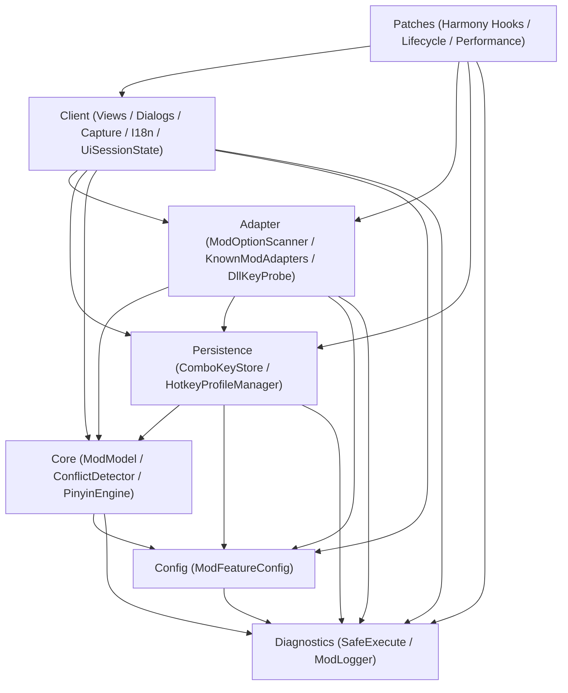

# 《深空当铺》「可能是按键统一优化」架构蓝图 (docs/ARCHITECTURE.md)

> **维护说明**：本文件记录《深空当铺》（*Probably Stolen*）模组 `probably_unified_hotkeys`（目标版本 `v1.5.0`）的整体系统架构、7 层依赖拓扑、持久化数据契约、以及从巨石代码解耦的架构决断。所有协作者必须以此为准，严禁发生逆向跨层调用。

---

## 1. 架构目标与设计原则

面向《深空当铺》官方原生 Mod SDK（非 BepInEx），本模组旨在提供一站式原生统一快捷键管理与模组配置中心。针对历史版本巨石 UI 耦合严重、数据模型污染 UI 句柄、反射异常难以追踪等痛点，`v1.5.0` 确立以下核心架构原则：

1. **单向分层拓扑（Unidirectional Layered Architecture）**：严格遵循 `Diagnostics` -> `Config` -> `Core` -> `Persistence` -> `Adapter` -> `Patches` -> `Client` 的单向依赖约束，彻底消除循环依赖与逆向耦合。
2. **纯领域数据模型（Pure Domain Models）**：彻底修复 `v2` 设计缺陷，`Core/Model` 严禁引用任何 Unity UI 控件（零 `GameObject` / `CustomUIElement` 引用），所有运行时 UI 句柄与基准快照转移至 `Client/State/UiSessionState.cs` 独立管理。
3. **薄钩子（Thin Hooks）与异常防崩隔离**：Harmony 钩子仅作为事件管道，不包含任何业务实现；所有外部适配与高危调用均通过 `Diagnostics.SafeExecute` 捕获隔离，杜绝因单个 Mod 异常引发主循环崩溃或弹窗卡死。
4. **默认 0 权限纯净契约**：发布构建保持 `<Capabilities />` 为空，零外部读盘，通过官方 `ModScanner` 静态全绿门禁。

---

## 2. 7 层架构依赖拓扑



### 层级职责与约束明细

| 层级 (Layer) | 命名空间前缀 | 核心职责 | 绝对禁止事项 |
|---|---|---|---|
| **1. Diagnostics** | `ProbablyUnifiedHotkeys.Diagnostics` | 统一日志门面（`ModLogger`）、结构化日志格式、异常隔离网（`SafeExecute`）、防崩兜底降级 | 严禁依赖上层业务模型或 UI 组件 |
| **2. Config** | `ProbablyUnifiedHotkeys.Config` | 模组自身类型化配置管理（`ModFeatureConfig`），与官方 `ModConfig` 双向绑定 | 严禁包含 UGUI 视图装配或 Harmony 钩子代码 |
| **3. Core** | `ProbablyUnifiedHotkeys.Core` | 纯领域数据模型（`ModModel`）、按键冲突分组算法（`ConflictDetector`）、离线拼音繁简词库与键码词元边界检索（`PinyinEngine`、`TradSimpTable`） | **绝对禁止引用 `UnityEngine.UI`、`TMPro`、`GameObject` 或任何 UI 句柄** |
| **4. Persistence** | `ProbablyUnifiedHotkeys.Persistence` | `PlayerPrefs` 存储管理（`ComboKeyStore`）、预设方案 JSON 快照编解码（`HotkeyProfileManager`）、`KeyCode.None` 严格修饰位清理 | 严禁持有具体卡片视图或按钮句柄 |
| **5. Adapter** | `ProbablyUnifiedHotkeys.Adapter` | 官方 `GameOptionRegistry` 与各模组 `ModConfig` 扫描（`ModOptionScanner`）、知名工坊模组桥接（`KnownModAdapters`）、可选静态热键探测（`DllKeyProbe`） | 严禁直接修改 UI 树结构 |
| **6. Patches** | `ProbablyUnifiedHotkeys.Patches` | Harmony 2.4.2 薄钩子（`ModEntry` 生命周期、`GameOptionUIManager` 拦截、`PerformancePatches` 优化秒退与改造件行池） | 严禁在补丁内编写长业务、长反射或每帧分配 |
| **7. Client** | `ProbablyUnifiedHotkeys.Client` | 表现与交互层：运行时 UI 状态管理（`UiSessionState`）、三层分区本地化（`SectionLocalizer`、`I18n`）、拆分后的 10 个正交 UI 视图组件 | 严禁将 UI 句柄泄露给 `Core` 层模型 |

---

## 3. 源码目录结构与物理映射

项目最终编译为单程序集 `ProbablyUnifiedHotkeys.dll`（目标框架 `netstandard2.1`）：

```plaintext
probably_unified_hotkeys_re/
├── src/
│   └── ProbablyUnifiedHotkeys/     # 主模组工程 (netstandard2.1)
│       ├── ProbablyUnifiedHotkeys.csproj
│       ├── manifest.xml            # 模组清单元数据 (v1.5.0, 0 权限纯净)
│       ├── preview.png             # 工坊与改造件预览图
│       ├── assets/
│       │   └── pinyin.bin          # 嵌入式拼音词库二进制文件 (LogicalName: ProbablyUnifiedHotkeys.pinyin.bin)
│       ├── Diagnostics/            # 基础设施：异常隔离与日志门面
│       │   ├── ModLogger.cs        # 统一结构化日志输出（[ProbablyUnifiedHotkeys][LEVEL]）
│       │   └── SafeExecution.cs    # SafeExecute / SafeFunc 异常防崩隔离网
│       ├── Config/                 # 模组配置中心
│       │   └── ModFeatureConfig.cs # 官方 ModConfig 注册与 7 大模块化开关管理
│       ├── Core/                   # 纯领域逻辑与算法层（零 UI 依赖）
│       │   ├── Model/
│       │   │   └── ModModel.cs     # 纯领域实体（VanillaSectionCard、ModOptionGroup、ModHotkeyEntry 等，不含 GameObject）
│       │   ├── Conflict/
│       │   │   └── ConflictDetector.cs # 精确跳过 KeyCode.None 的冲突分组与判重
│       │   └── Search/
│       │       ├── PinyinEngine.cs # 20,902 字离线汉字拼音转换与首字母检索
│       │       └── TradSimpTable.cs # 繁简互搜对照表与 MatchesKeyCodeSearchToken 边界匹配
│       ├── Persistence/            # 持久化与快照管理层
│       │   ├── ComboKeyStore.cs    # PlayerPrefs combos.v1 / forced / ignored 契约与修饰键严格管理
│       │   └── HotkeyProfileManager.cs # 3 套方案槽位读写、剪贴板紧凑 JSON 导入导出与 puh_profile_v1 Schema 校验
│       ├── Adapter/                # 引擎与工坊生态适配层
│       │   ├── Scanner/
│       │   │   ├── ModOptionScanner.cs # GameOptionRegistry / ModConfig 实例扫描与委托归属解析
│       │   │   └── ModCatalogCache.cs  # 主菜单空闲预热与配置目录缓存
│       │   ├── ExternalMods/
│       │   │   └── KnownModAdapters.cs # SpeedUp / SmartInventoryArrange / Trainer 等 11 款模组专项委托适配
│       │   └── StaticProbe/
│       │       └── DllKeyProbe.cs  # 基于 DseCecil 的只读 IL 探测（受 DISABLE_DLL_KEY_PROBE 宏剔除）
│       ├── Patches/                # Harmony 2.4.2 薄钩子层
│       │   ├── Lifecycle/
│       │   │   └── ModEntry.cs     # IMod 生命周期、GameOptionUIManager / KeyBindHelper / HandleEscape 薄钩子
│       │   └── Performance/
│       │       └── PerformancePatches.cs # 选项开窗离线预热、改造件 RowPool 对象池、秒退旁路
│       └── Client/                 # 表现与交互层 (UGUI / TextMeshPro)
│           ├── State/
│           │   └── UiSessionState.cs # 【v1.5.0 核心补齐】独立承载运行时 UI 句柄、BaselineSnapshot 与脏状态机
│           ├── I18n/
│           │   ├── I18n.cs         # 中英双语词典、字体回退应用与热切换事件
│           │   └── SectionLocalizer.cs # 三层根治式模组分区标题本地化引擎
│           └── UI/                 # 原 5,100+ 行巨石 UnifiedOptionUI.cs 正交拆解
│               ├── UnifiedOptionWindow.cs     # 主窗口调度器、离线装配编排与生命周期管理
│               ├── UnsavedConfirmDialog.cs    # 退出设置未保存防丢确认弹窗（保存并退出 / 放弃修改 / 取消）
│               ├── TopSearchAndActionBar.cs   # 第一行四模式搜索栏 + 第二行统一操作栏
│               ├── CollapsibleCardView.cs     # 原版与模组统一折叠卡片渲染
│               ├── KeyCaptureController.cs    # 按键/组合键/侧键捕获状态机与 Esc 吸收门控
│               ├── ConflictAggregationView.cs # [!] 仅看冲突聚合视图与就地快捷改键
│               ├── ModDiagnosticView.cs       # 模组排查四分类视图与信息复制
│               ├── ProfilePresetCardView.cs   # 独立折叠卡片内的 3 套预设与剪贴板 JSON 交互
│               └── UiLayoutAndFontHelper.cs   # FittedFontSizeCache 单次字号拟合与固定间距样式工具
│
├── tests/                          # 纯逻辑单元测试工程
│   └── ProbablyUnifiedHotkeys.Tests/
│       └── ProbablyUnifiedHotkeys.Tests.csproj
├── tools/                          # ScannerCheck（.NET 8）与发布工具链 (check_mod.ps1 / publish_workshop.ps1)
└── docs/                           # 架构蓝图、踩坑账本、发布规范与交接三件套
```

---

## 4. UI 运行时状态与领域模型彻底解耦设计（`UiSessionState`）

### 4.1 历史缺陷诊断
在 `v1` 及早期设计中，`ModModel.cs` 中的实体直接持有了大量 Unity UI 控件：
```csharp
// 历史反模式（已废弃）：数据实体强耦合 UI 控件
public class ModHotkeyEntry {
    public CustomUIElement? BoundElement;
    public GameObject? RowObject;
}
```
这导致领域模型无法独立做单元测试，且缓存重置（`ModCatalogCache.ResetUiSessionState`）必须反向遍历所有领域实体将控件置空，极易引发内存泄漏或游离引用。

### 4.2 `v1.5.0` 解耦方案：引入 `UiSessionState.cs`
1. **纯净领域实体**：`Core/Model/ModModel.cs` 内的 `ModHotkeyEntry`、`ModOptionGroup`、`VanillaSectionCard` 仅保留配置键名、描述文本、键位结构、默认值及只读状态等纯业务字段。
2. **会话状态集中化**：所有运行时的 `GameObject`、`CustomUIElement`、折叠箭头动画句柄、输入框控制器等，统一由 `src/Client/State/UiSessionState.cs` 维护字典索引（通过 `EntryKey` 映射）：
```csharp
namespace ProbablyUnifiedHotkeys.Client.State
{
    public sealed class UiSessionState
    {
        // 运行时 UI 句柄缓存（按 EntryKey 索引）
        private readonly Dictionary<string, CustomUIElement> _boundElements = new();
        private readonly Dictionary<string, GameObject> _rowObjects = new();

        // 基准快照与脏状态检测
        public BaselineSnapshot CurrentBaseline { get; private set; } = new();
        public bool HasUnsavedChanges { get; set; }

        public void CaptureBaseline(IEnumerable<ModHotkeyEntry> entries, IEnumerable<ModOptionGroup> groups);
        public void ResetSession();
    }
}
```

---

## 5. 持久化数据契约与配置协议

### 5.1 Unity `PlayerPrefs` 持久化键契约（版本 `v1`）

本模组在 Unity `PlayerPrefs` 命名空间下注册以下 6 项标准键，且必须严格遵循向下兼容解析：

| 键名 (Key) | 数据类型 | 格式与 Schema 说明 | 容错与降级策略 |
|---|---|---|---|
| `probably_unified_hotkeys.combos.v1` | `string` | 分号 `;` 分割的 `<EntryKey>=<Modifiers>:<PrimaryKey>` 键值对 | 存储快捷键修饰位与鼠标侧键（`Mouse3~Mouse6`）。**铁律：当目标键为 `KeyCode.None` 时严禁返回残留修饰位** |
| `probably_unified_hotkeys.forced_hotkeys.v1` | `string` | 分隔符连接的 `<ModId>:<ConfigKey>` 集合 | 存储玩家在「模组排查」中点击 `设为按键绑定` 强制纳管的疑难 `string`/`int` 配置项 |
| `probably_unified_hotkeys.ignored_candidates.v1` | `string` | 分隔符连接的 `<ModId>:<ConfigKey>` 集合 | 存储玩家在「模组排查」中标记为 `忽略(非按键)` 的候选项，永久免打扰 |
| `probably_unified_hotkeys.profile_active_slot.v1` | `int` | `0` ~ `2`（对应预设方案一 ~ 方案三） | 当前激活的场景预设索引；越界时自动回退为 `0` |
| `probably_unified_hotkeys.profile_slot_json.v1.<0..2>` | `string` | 遵循 `puh_profile_v1` 的紧凑 JSON 字符串 | 各预设槽位的全量键位、通用设置、强转表与忽略表快照数据 |
| `probably_unified_hotkeys.profile_slot_meta.v1.<0..2>` | `string` | `<HotkeyCount>\|<GeneralCount>\|<Timestamp>` | 轻量级元数据摘要，供预设卡片列表无需反序列化直接高性能渲染 |

### 5.2 方案快照 JSON Schema（`puh_profile_v1`）

用于方案本地槽位存储与剪贴板跨设备一键分享：

```json
{
  "schema": "puh_profile_v1",
  "version": "1.5.0",
  "name": "方案一 (日常)",
  "ts": "2026-11-18 18:00",
  "hk": {
    "vanilla:call_next_customer": "Ctrl+E",
    "vanilla:toggle_store": "Space"
  },
  "chk": {
    "SpeedUp: ToggleSpeedKey": "Alt+Equals"
  },
  "gen": {
    "probably_unified_hotkeys:enable_pinyin_search": "True",
    "probably_unified_hotkeys:enable_fast_quit": "True"
  },
  "forced": [
    "some_mod:custom_string_hotkey"
  ],
  "ignored": [
    "some_mod:display_resolution_index"
  ]
}
```

- **校验安全铁律**：导入剪贴板文本时，必须严格校验 `"schema": "puh_profile_v1"`。遇到未知字段或格式异常时跳过并记录告警，严禁抛出未处理异常崩溃设置面板。

### 5.3 官方 `ModConfig` 配置项契约（模组 ID：`probably_unified_hotkeys`）

所有选项支持在游戏内「改造件」齿轮与「选项」卡片双入口无缝热生效：

| 配置键 (Key) | 数据类型 | 默认值 | 作用与说明 |
|---|---|---|---|
| `ui_language` | `string` | `"auto"` | 界面语言：`"auto"`（跟随游戏语言，非中文回退英文）/ `"zh"` / `"en"` |
| `enable_dll_probe` | `bool` | `false` | 静态热键探测开关（默认 0 权限纯净包中该项被编译宏剔除隐藏） |
| `enable_performance_patches` | `bool` | `true` | 流畅度深度优化补丁（开窗预热、字号拟合缓存、改造件行池化、去重） |
| `enable_fast_quit` | `bool` | `true` | 优化退出流程（秒退，配置安全落盘后旁路冗余反注册与遥测超时） |
| `enable_pinyin_search` | `bool` | `true` | 20,902 字离线拼音与繁简中文检索 |
| `enable_key_suppression` | `bool` | `true` | 组合键精确抑键与单裸键防误触互斥隔离 |
| `enable_debug_logging` | `bool` | `false` | 结构化调试诊断日志输出开关（输出详细适配与生命周期轨迹） |
