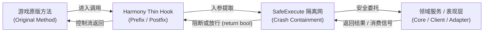

# 《深空当铺》Harmony 补丁开发与解耦规范 (docs/HARMONY_SPEC.md)

> **维护说明**：本规范针对《深空当铺》（*Probably Stolen*）官方内置的 **0Harmony 2.4.2** 运行环境及官方静态字节码审计工具 **ModScanner** 深度定制。所有编写、重构或审查 Harmony 补丁的协作者必须严格对照本规范执行。

---

## 1. 运行环境与生命周期概述

《深空当铺》运行于 **Unity 2021.3.45f2 (64位) Mono BleedingEdge** 运行时，并非 BepInEx 架构。游戏内置了官方模组加载框架（`Assembly-CSharp.dll` 中的 `IMod`、`LoadedMod`、`ModLoader`），并在 `Managed/` 目录中集成了 `0Harmony.dll`（版本 `2.4.2.0`）。

### 1.1 生命周期接入点
- **初始化注册 (`IMod.Init`)**：创建专属命名空间的 `Harmony` 实例（如 `new Harmony("probably_unified_hotkeys")`），按需注册基础补丁。
- **启用 (`IMod.OnEnable`)**：激活生命周期与选项拦截补丁。
- **禁用 (`IMod.OnDisable`)**：严格反向卸载自身挂载的钩子，释放静态缓存与事件监听。
- **退出游戏 (`Application.quitting`)**：识别退出信号，保存配置并走极速秒退链路。

---

## 2. Thin Hook（薄钩子）解耦法则

**薄钩子铁律**：严禁在 `[HarmonyPatch]` 内部直接编写复杂的业务计算、长反射查找、UI 控件生成或遍历操作。Harmony 补丁的唯一合法定位是**事件分发管道与上下文适配器**。



### 2.1 薄钩子编写范式
```csharp
[HarmonyPatch(typeof(GameOptionUIManager), nameof(GameOptionUIManager.OpenUI))]
internal static class Patch_GameOptionUIManager_OpenUI
{
    // Prefix 仅负责：提取参数 -> 注入异常防护网 -> 转发给 Client 服务 -> 决定是否阻断原版
    [HarmonyPrefix]
    public static bool Prefix(GameOptionUIManager __instance)
    {
        return SafeExecution.SafeFunc(() =>
        {
            // 转发给表现层主窗口调度器
            return UnifiedOptionWindow.Instance.HandleOpenUI(__instance);
        }, fallbackValue: true); // 若抛出异常，优雅降级放行原版，杜绝黑屏死锁
    }
}
```

---

## 3. 异常防崩网与安全执行规范（彻底消灭空 `catch {}`）

在模组生态中，由于第三方模组版本更替、非预期入参或游戏内部状态未就绪，任何非受保护的代码均可能抛出未处理异常。若模组异常直接上抛穿透到 Unity 引擎主循环，会导致整帧逻辑中断、按键完全失灵甚至游戏崩溃（CTD）。

### 3.1 彻底消灭空 `catch {}`
**历史反模式**：在反射或跨模组调用处编写 `catch { }` 强行吞没异常，导致排错排障极其困难，问题被掩盖数月。

**标准规范**：全库必须使用统一的 `Diagnostics.SafeExecution` 包装器：
```csharp
namespace ProbablyUnifiedHotkeys.Diagnostics
{
    public static class SafeExecution
    {
        public static void SafeExecute(Action action, string contextInfo = "")
        {
            try
            {
                action();
            }
            catch (Exception ex)
            {
                ModLogger.Warn($"[SafeExecute] 捕获异常在上下文: {contextInfo} - {ex.Message}");
                if (ModFeatureConfig.EnableDebugLogging)
                {
                    ModLogger.Debug(ex.ToString());
                }
            }
        }

        public static T SafeFunc<T>(Func<T> func, T fallbackValue, string contextInfo = "")
        {
            try
            {
                return func();
            }
            catch (Exception ex)
            {
                ModLogger.Warn($"[SafeFunc] 捕获异常在上下文: {contextInfo}, 触发降级回退 - {ex.Message}");
                if (ModFeatureConfig.EnableDebugLogging)
                {
                    ModLogger.Debug(ex.ToString());
                }
                return fallbackValue;
            }
        }
    }
}
```

---

## 4. 重载方法显式签名匹配规范

### 4.1 歧义匹配灾难 (`AmbiguousMatchException`)
游戏底层核心类（如 `GameOptionUIManager`、`CustomUIWindow`、`CustomUIBuilder`）大量使用了方法重载（例如同时存在 `StartCapture(string)` 与 `StartCapture(int)`）。若仅凭方法名进行注入，Harmony 会在启动时直接抛出 `AmbiguousMatchException`。

### 4.2 显式参数类型数组声明
**强制要求**：凡是被修补的目标方法具有同名重载，必须在静态属性注解或动态注入方法中提供完整的 `new Type[] { ... }` 签名：

```csharp
// 正确写法：显式指定重载参数类型数组
[HarmonyPatch(typeof(GameOptionUIManager), nameof(GameOptionUIManager.StartCapture), new Type[] { typeof(string) })]
internal static class Patch_GameOptionUIManager_StartCapture
{
    [HarmonyPrefix]
    public static bool Prefix(string keyId)
    {
        // ...
        return true;
    }
}
```

若通过动态反射挂钩：
```csharp
var targetMethod = AccessTools.Method(
    typeof(CustomUIWindow), 
    nameof(CustomUIWindow.Get), 
    new Type[] { typeof(string) }
);
```

---

## 5. 官方 `ModScanner` 静态合规与反射安全准则

### 5.1 字面量显式解析与消除 `computed type`
官方 `ModScanner` 基于 Cecil 进行静态字节码审计。如果分析器在 IL 中遇到基于动态变量计算类型（如 `__instance.GetType()`），会判定该类型具有不确定性，抛出 `AccessTools.Field on a computed type` 告警。

- **规范**：
  1. 目标类型如果是公开已知类型，使用强类型 `typeof(TargetClass)`。
  2. 目标类型若为内部非公开类型，必须使用完全限定名字符串字面量：
     ```csharp
     var type = AccessTools.TypeByName("Namespace.InternalTargetClass");
     ```
  3. 绝对禁止将运行时动态对象传入 `GetType()` 后参与 `AccessTools` 查找。

### 5.2 零外部无命名空间反射红线 (`reflection-external`)
官方《APIChanges》规定：自 2026-12-10 起，所有对无命名空间的外部第三方类型（例如直接定义在全局命名空间的 `trainer` 类或第三方单例）执行的反射和补丁注入，将被强制标记为 `reflection-external` 违规，导致模组直接被官方加载器拒绝启用（`Refused=True`）。

- **规范**：
  1. 严禁使用 Harmony 去 Patch 任何无根命名空间的第三方 Mod。
  2. 该类 Mod 的数据交互必须降级为只读其磁盘配置文件（`ModData` 沙盒内）或使用官方通用通道。

---

## 6. 热路径委托化与缓存更新机制

### 6.1 绝对禁止热路径反射
在每秒执行数十次或数百次的高频执行路径中（如 `Update` 帧循环、`Input.GetKeyDown` 拦截、`KeyBindHelper.PollCapture` 录入轮询、`ConfigEntry<T>.Value` Getter 拦截），严禁执行：
- `MethodInfo.Invoke` / `FieldInfo.GetValue`
- `AccessTools.Method` / `AccessTools.TypeByName`
- `GameObject.Find` / `GetComponentInChildren`
- 字符串拼接分配与 `Enum.GetValues`

### 6.2 强类型委托绑定与 `assemblyEpoch`
所有跨程序集或非公开成员的反射调用，必须在初始化阶段一次性转换为强类型委托并持久缓存于静态字段中：

```csharp
public static class FastInvokerCache
{
    public static Func<object, KeyCode>? GetCustomKeyCodeDelegate;
    private static int _cachedAssemblyEpoch = -1;

    public static void EnsureInitialized(int currentEpoch)
    {
        if (_cachedAssemblyEpoch == currentEpoch && GetCustomKeyCodeDelegate != null)
            return;

        var targetType = AccessTools.TypeByName("ThirdPartyMod.TargetClass");
        if (targetType != null)
        {
            var method = AccessTools.Method(targetType, "GetKeyCode");
            if (method != null)
            {
                GetCustomKeyCodeDelegate = (Func<object, KeyCode>)Delegate.CreateDelegate(
                    typeof(Func<object, KeyCode>), 
                    method
                );
            }
        }
        _cachedAssemblyEpoch = currentEpoch;
    }
}
```

---

## 7. 补丁生命周期卫生与秒退旁路

### 7.1 限定专属 Harmony ID 卸载
**灾难场景**：调用无参的 `harmony.UnpatchAll()` 会将整个游戏进程中所有模组挂载的数百个补丁一并撤销，导致其他模组瞬间崩溃。

**规范**：卸载补丁时必须限定自身专属的 Harmony ID：
```csharp
public void Unload()
{
    if (_harmony != null)
    {
        _harmony.UnpatchAll(_harmony.Id); // 仅卸载本模组打入的补丁，绝对不触碰其他模组
    }
}
```

### 7.2 退出游戏秒退旁路
原版退出流程中，游戏会逐个等待动态补丁反编译反注册并等待遥测网络请求超时，造成退出卡顿 2~5 秒。

**规范**：
1. 监听 `Application.wantsToQuit` 与 `Application.quitting` 事件。
2. 在捕获退出信号时，首先同步刷新并落盘 `PlayerPrefs`，确保玩家配置安全。
3. 当确认进入退出状态时，在 `PerformancePatches.cs` 中旁路掉耗时反注册与网络遥测逻辑，直接放行进程秒退。
