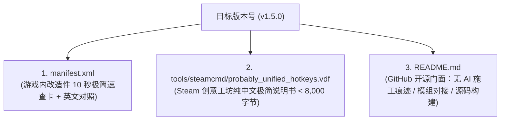

# 《深空当铺》模组标准化发布作业程序 (docs/RELEASE_SOP.md)

> **版本**：`v1.5.0`  
> **适用模组**：`probably_unified_hotkeys`（Steam 创意工坊 ID: `3837828444`）  
> **目的**：确立三段式语义化版本发布标准、官方 `ModScanner` 零权限静态门禁、标准 4 文件部署包契约、GitHub Actions Tag 自动化发布流水线，以及解决 Steam 创意工坊 `schinese` 槽位覆盖陷阱的闭环发布 SOP。

---

## 1. 语义化版本规范 (Semantic Versioning)

本模组严格遵循 [SemVer 2.0.0](https://semver.org/lang/zh-CN/) 规范，版本号格式为 `MAJOR.MINOR.PATCH`（如 `1.5.0`）：

| 版本段 | 升级条件 | 归零规则 | 示例说明 |
|---|---|---|---|
| **MAJOR (主版本)**<br/>`X.0.0` | **不向下兼容的破坏性变更**：<br/>1. 调整持久化 Schema 且不再兼容旧配置；<br/>2. 底层架构推翻级重构。 | 次版本、修订号归零 | `1.4.7` → `2.0.0` |
| **MINOR (次版本)**<br/>`X.Y.0` | **向下兼容的重要特性扩展与架构重构**：<br/>1. 巨石 UI 模块正交解耦与分层架构落地；<br/>2. 新增核心子视图或重大增强功能（不破坏旧配置）。 | 修订号归零 | **`1.4.7` → `1.5.0`（当前发布版本）** |
| **PATCH (修订版本)**<br/>`X.Y.Z` | **向下兼容的 Bug 修复与微调**：<br/>1. 修复 UI 排版、搜索误命中或偶发空指针；<br/>2. 新增第三方模组适配或更新游戏版本适配号。 | 保持前两位不变 | `1.5.0` → `1.5.1` |

---

## 2. 三端文案差异化定位与极简说明书文风准则

在发版前，必须严格依照**用户友好原则**与**内外分层准则**，维护以下三端对外文案：



### 2.1 三端文案差异化定位与职责划分
1. **游戏内清单 (`manifest.xml`)**：
   - 定位为**「10 秒速查卡」**，供玩家在游戏主菜单「改造件」列表中扫视阅读；
   - 中文上半部控制在 12 行以内（1 句定位 + 2~3 行操作说明 + 5~6 条单行短句功能），底部附带精炼地道的英文短句对照。
2. **创意工坊说明书 (`probably_unified_hotkeys.vdf`)**：
   - 定位为**面向 Steam 玩家的纯中文说明书**；
   - 包含主要功能、快速上手、兼容与安全说明、FAQ 真实答疑与反馈入口；彻底移除需求文档草稿与内部参数边界章节；
   - 体积铁律：`description` 字段转换为 UTF-8 编码后，**必须严格小于 8,000 字节**。
3. **开源代码门面 (`README.md`)**：
   - 定位为**专业、克制的开源项目主页**；
   - 严格执行**内外分层**：彻底移除关于 `AGENTS.md`、AI 协作宪章、`handoff/` 等一切内部协作施工痕迹；
   - 面向玩家提供清晰的功能与安装指引，面向模组作者提供标准 `ModConfig` / `Localization` 自动收纳对接说明，面向开发者提供 3 行命令构建指引。

### 2.2 极简说明书文风与禁词表（最高文案铁律）
- **调性准则**：零寒暄、零夸张修辞、纯短条目直给，克制清爽。
- **100% 禁词表（严禁在对外玩家文案中使用）**：
  - **禁 AI 罐头套话**：严禁出现“一站式原生中心”、“全链路流畅度重构”、“三层根治式引擎”、“四模式检索”、“赋能”、“深度重构”、“正交解耦”、“薄钩子防崩隔离”等八股大词；
  - **禁底层实现黑话**：严禁向普通玩家展示 `SetActive(false)`、`FittedFontSizeCache`、`RowPool`、`LoadedMod.Localization`、`puh_profile_v1`、`DseCecil` 等底层类名与实现术语。
- **用户获益视角更新说明口径**：
  发版更新日志（`changenote`）必须从玩家切身获益视角进行提炼，例如：
  - 底层代码重写加固，新增独立异常隔离保护（单个第三方模组配置异常不再连累整个选项页报错）；
  - 适配官方最新安全检测标准，默认 0 权限纯净运行、无安全警告弹窗；
  - 优化按键设为空（「无」）时的未保存判定与预设快照读写稳定性。

---

## 3. 部署目录标准 4 文件契约与静态门禁

### 3.1 部署目录 4 文件纯净契约
模组编译输出至游戏部署目录 `Mods\probably_unified_hotkeys\`，内部**严禁混入任何多余文件或子目录**，仅允许包含以下 4 个标准文件：

1. `ProbablyUnifiedHotkeys.dll`：模组唯一程序集（依赖的游戏与引擎库全部设为 `<Private>false</Private>`）。
2. `manifest.xml`：官方模组清单元数据（默认保持 `<Capabilities />` 为空）。
3. `README.md`：模组说明与指南。
4. `preview.png`：游戏内改造件面板与工坊展示封面。

> **排除项提醒**：`.pdb` 符号文件、`tools/` 脚本、`docs/` 目录以及任何测试产物严禁进入部署包。

### 3.2 官方 `ModScanner` 零权限静态门禁
必须通过独立 .NET 8 工具 `tools/ScannerCheck` 进行官方静态 IL 扫描，输出必须完全满足：
- `Detected Capabilities`: `0`（默认 0 权限纯净模式）
- `HardFlags`: `0`
- `Pending`: `0`
- `DeprecatedCapabilities`: `0`
- `UsesDeprecatedReflection`: `False`
- `Refused`: `False`

---

## 4. 本地自动化预检命令 (`check_mod.ps1`)

在执行 Git 提交或发布前，本地必须运行并通过四合一预检脚本：

```powershell
.\tools\check_mod.ps1
```

该脚本将自动执行以下 4 步严格自检：
1. 调用 `dotnet build src/ProbablyUnifiedHotkeys/ProbablyUnifiedHotkeys.csproj -c Release` 验证无 Error、无 Warning；
2. 扫描 `Mods\probably_unified_hotkeys\` 目录，校验严格仅含 4 个合法文件；
3. 统计并校验 VDF 描述文本字节数严格 `< 8,000` 字节；
4. 编译并运行 `tools/ScannerCheck`，执行游戏官方 `ModScanner.Scan` 字节码静态安全门禁。

---

## 5. 发版前置审批门禁与 GitHub Actions 自动化发布流程

### 5.0 正式发布前强制备份与人工审阅门禁（最高红线）
在执行任何 `git push`、打版本 Tag 或上传创意工坊前，**必须先完成以下两步并获得老板明确批准**：
1. **离线版本备份封存**：将当前待发布版本的标准 4 文件与 `.zip` 压缩包完整备份留档；
2. **三端定稿简介呈审**：将 `manifest.xml`、`README.md` 以及工坊简介的**无 BBCode 纯净阅读文档**呈交老板过目签字，未获明确同意严禁执行上传或推送。

### 5.1 触发流程（无损历史保留）
```powershell
# 1. 将通过 check_mod.ps1 验证的最新正式 DLL 同步至 CI 兜底资产目录
Copy-Item "src/ProbablyUnifiedHotkeys/bin/Release/netstandard2.1/ProbablyUnifiedHotkeys.dll" ".github/release-assets/ProbablyUnifiedHotkeys.dll" -Force

# 2. 提交并推送主分支，创建语义化 Tag 触发自动打包挂载 Release
git push origin main
git tag -a v1.5.0 -m "Release v1.5.0"
git push origin v1.5.0
```

### 5.2 CI 自动化作业 (`.github/workflows/release.yml`)
1. **Runner 环境**：`windows-latest`。
2. **智能双源打包**：若云端存在游戏 `Managed` 依赖缓存则在线运行单测并编译；若云端无游戏私有程序集，则自动取用经本地 `ModScanner` 零权限门禁验证过的 `.github/release-assets/ProbablyUnifiedHotkeys.dll`，与 `manifest.xml`、`README.md`、`preview.png` 组装为标准 4 文件压缩包 `ProbablyUnifiedHotkeys-v1.5.0.zip`。
3. **自动创建 Release**：通过 `softprops/action-gh-release@v2` 自动发布正式 GitHub Release 并挂载 `.zip` 下载附件。

---

## 6. Steam 创意工坊双语槽位发布 SOP

### 6.1 为什么必须同步 `english` 与 `schinese` 双槽位？
Valve Steamworks UGC API 对工坊物品的语言槽位（如 `schinese` 简体中文、`english` 默认槽位）**不提供删除接口**。一旦物品曾写入过 `schinese` 槽位，中文 Steam 客户端将**永久优先**读取该槽位。因此每次发版必须同时更新 `english` 默认槽位（含 4 文件内容包、封面与更新日志）与 `schinese` 中文槽位。

### 6.2 首选标准流程：桌面 Steam 免掉线一键双槽位发布（推荐）
当本地桌面 Steam 客户端已启动并登录作者账号时，直接运行一行命令即可完成全套预检、4 文件内容包上传、`english` + `schinese` 双槽位标题/简介同步及更新日志写入，**全程不会踢掉桌面 Steam 登录态，无需重复输入手机令牌**：

```powershell
.\tools\publish_workshop.ps1 -Step publish
```
- **自动执行链路**：
  1. 自动调用 `check_mod.ps1` 完成 Release 编译、4 文件纯净审计、VDF 字节数校验与 `ScannerCheck` 零权限扫描；
  2. 调用 `SteamTagger --publish-full` 通过桌面 Steam IPC 上传内容包、封面、`english` 默认槽位描述及 `changenote`（返回 `k_EResultOK`）；
  3. 紧接着自动同步 `schinese` 简体中文槽位标题与描述（返回 `k_EResultOK`），并回查校验线上双槽位最新时间戳与体积。

### 6.3 备选降级流程：无桌面客户端时分步使用 `steamcmd`
仅在未运行桌面 Steam 客户端时使用（注意：`steamcmd` 登录会顶掉桌面 Steam 会话）：
1. 上传文件与默认槽位：`.\tools\publish_workshop.ps1 -Step default`
2. 重新登录桌面 Steam 客户端并验真：`.\tools\publish_workshop.ps1 -Step query`
3. 覆盖 `schinese` 槽位：`.\tools\publish_workshop.ps1 -Step schinese -SkipCheck`

### 6.4 工坊页面最终验收
在浏览器或 Steam 客户端中打开创意工坊页面：  
[https://steamcommunity.com/sharedfiles/filedetails/?id=3837828444](https://steamcommunity.com/sharedfiles/filedetails/?id=3837828444)  
核验页面展示的版本号、特性说明、更新日期与排版渲染无误。
