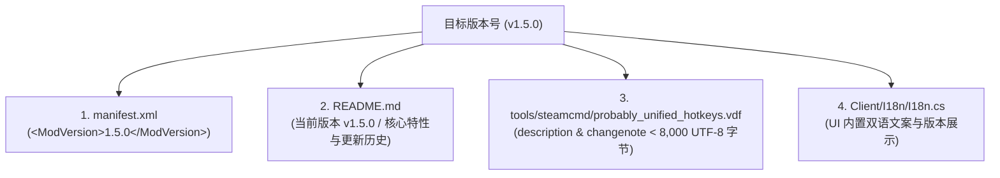
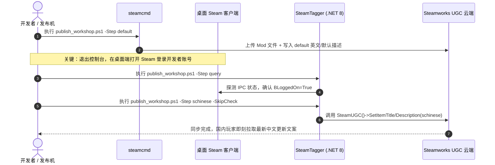

# 《深空当铺》模组标准化发布作业程序 (docs/RELEASE_SOP.md)

> **版本**：`v1.5.0`  
> **适用模组**：`probably_unified_hotkeys`（Steam 创意工坊 ID: `3837828444`）  
> **目的**：确立三段式语义化版本发布标准、官方 `ModScanner` 零权限静态门禁、标准 4 文件部署包契约、GitHub Actions Tag 自动化发布流水线，以及解决 Steam 创意工坊 `schinese` 槽位覆盖陷阱的闭环发布 SOP。

---

## 1. 语义化版本规范 (Semantic Versioning)

本模组严格遵循 [SemVer 2.0.0](https://semver.org/lang/zh-CN/) 规范，版本号格式为 `MAJOR.MINOR.PATCH`（如 `1.5.0`）：

| 版本段 | 升级条件 | 归零规则 | 示例说明 |
|---|---|---|---|
| **MAJOR (主版本)**<br/>`X.0.0` | **不向下兼容的破坏性变更**：<br/>1. 调整持久化 Schema 且不再兼容旧配置；<br/>2. 底层架构推翻级重构。 | 次版本、修订号归零 | `1.4.7` → `2.0.0` |
| **MINOR (次版本)**<br/>`X.Y.0` | **向下兼容的重要特性扩展与架构重构**：<br/>1. 巨石 UI 模块正交解耦与分层架构落地；<br/>2. 新增核心子视图或重大增强功能（不破坏旧配置）。 | 修订号归零 | **`1.4.7` → `1.5.0`（当前发布版本）** |
| **PATCH (修订版本)**<br/>`X.Y.Z` | **向下兼容的 Bug 修复与微调**：<br/>1. 修复 UI 排版、搜索误命中或偶发空指针；<br/>2. 新增第三方模组适配或更新游戏版本适配号。 | 保持前两位不变 | `1.5.0` → `1.5.1` |

---

## 2. 四端文案强制对齐清单 (Four-End Alignment Matrix)

在打 Tag 发版前，必须同步核验以下四处文案的版本号与功能描述，确保 100% 一致：



> **VDF 体积铁律**：`tools/steamcmd/probably_unified_hotkeys.vdf` 中的 `description` 字段在转换为 UTF-8 编码后，**必须严格小于 8,000 字节**，否则 Valve 后端接口会静默截断或直接拒绝更新。

---

## 3. 部署目录标准 4 文件契约与静态门禁

### 3.1 部署目录 4 文件纯净契约
模组编译输出至游戏部署目录 `Mods\probably_unified_hotkeys\`，内部**严禁混入任何多余文件或子目录**，仅允许包含以下 4 个标准文件：

1. `ProbablyUnifiedHotkeys.dll`：模组唯一程序集（依赖的游戏与引擎库全部设为 `<Private>false</Private>`）。
2. `manifest.xml`：官方模组清单元数据（默认保持 `<Capabilities />` 为空）。
3. `README.md`：模组说明与指南。
4. `preview.png`：游戏内改造件面板与工坊展示封面。

> **排除项提醒**：`.pdb` 符号文件、`tools/` 脚本、`docs/` 目录以及任何测试产物严禁进入部署包。

### 3.2 官方 `ModScanner` 零权限静态门禁
必须通过独立 .NET 8 工具 `tools/ScannerCheck` 进行官方静态 IL 扫描，输出必须完全满足：
- `Detected Capabilities`: `0`（默认 0 权限纯净模式）
- `HardFlags`: `0`
- `Pending`: `0`
- `DeprecatedCapabilities`: `0`
- `UsesDeprecatedReflection`: `False`
- `Refused`: `False`

---

## 4. 本地自动化预检命令 (`check_mod.ps1`)

在执行 Git 提交或发布前，本地必须运行并通过四合一预检脚本：

```powershell
.\tools\check_mod.ps1
```

该脚本将自动执行以下 4 步严格自检：
1. 调用 `dotnet build src/ProbablyUnifiedHotkeys/ProbablyUnifiedHotkeys.csproj -c Release` 验证无 Error、无 Warning；
2. 扫描 `Mods\probably_unified_hotkeys\` 目录，校验严格仅含 4 个合法文件；
3. 统计并校验 VDF 描述文本字节数严格 `< 8,000` 字节；
4. 编译并运行 `tools/ScannerCheck`，执行游戏官方 `ModScanner.Scan` 字节码静态安全门禁。

---

## 5. GitHub Actions Tag 自动化发布流程

仓库配置了针对 Git Tag 的自动化 CI/CD 流水线（`.github/workflows/`）：

### 5.1 触发流程
```bash
# 1. 确认工作区完全干净且本地 check_mod.ps1 验证通过
git status

# 2. 创建符合语义化的发布 Tag 并推送到远端
git tag v1.5.0 -m "release: v1.5.0 official release"
git push origin v1.5.0
```

### 5.2 CI 自动化作业
1. **Runner 环境**：`windows-latest`，安装 .NET 8.0 SDK。
2. **构建与扫描**：
   - 执行 Release 编译；
   - 运行 `ScannerCheck` 静态安全扫描；
   - 提取部署目录下的标准 4 文件。
3. **打包发布**：
   - 压缩打包生成 `probably_unified_hotkeys_v1.5.0.zip`；
   - 自动生成 GitHub Release，包含对应版本号、校验哈希（SHA256）与从 `CHANGELOG.md` 提取的更新说明。

---

## 6. Steam 创意工坊 `SteamTagger` 双语槽位三步闭环 SOP

### 6.1 为什么必须三步闭环？
Valve Steamworks UGC API 对工坊物品的语言槽位（如 `schinese` 简体中文、`english` 默认英文）**不提供删除接口**。一旦物品曾写入过 `schinese` 槽位，中文 Steam 客户端将**永久优先**读取该槽位。如果仅使用普通的 `steamcmd` 命令行脚本更新，只会覆写 `default` 全局槽位，导致国内玩家看到的永远是过期的旧版说明。



### 6.2 详细执行步骤

#### 步骤一：上传模组文件与默认槽位更新
在终端中执行：
```powershell
.\tools\publish_workshop.ps1 -Step default
```
- **动作**：通过 `steamcmd` 将编译好的 4 个模组文件上传至创意工坊（工坊 ID: `3837828444`），并更新默认的英文说明与更新日志。

#### 步骤二：恢复桌面端 Steam 登录态与会话验真
- **动作**：在本地桌面打开 Steam 客户端，登录模组作者账号。
- **验真**：在终端运行：
```powershell
.\tools\publish_workshop.ps1 -Step query
```
- **预期结果**：控制台输出显示 `Steam Client Connected: True`、`BLoggedOn: True`，确认 IPC 句柄建立成功。

#### 步骤三：精准覆盖 `schinese` 语言槽位
在终端中执行：
```powershell
.\tools\publish_workshop.ps1 -Step schinese -SkipCheck
```
- **动作**：`tools/SteamTagger` 建立与桌面 Steam 的直接 IPC 连接，调用原生 `SteamUGC()->SetItemTitle(..., "schinese")` 与 `SetItemDescription(..., "schinese")`，将最新的简体中文标题、排版说明与更新日志覆写进工坊的 `schinese` 专属槽位。

#### 步骤四：工坊页面最终验收
在浏览器或 Steam 客户端中打开创意工坊页面：  
[https://steamcommunity.com/sharedfiles/filedetails/?id=3837828444](https://steamcommunity.com/sharedfiles/filedetails/?id=3837828444)  
核验页面展示的版本号（`v1.5.0`）、特性说明、更新日期与排版渲染无误。
