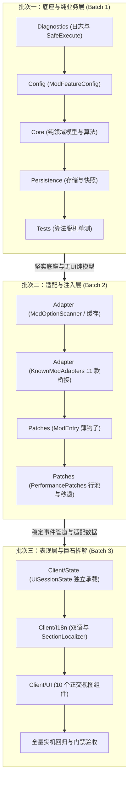

# 阶段 3 三批次拆解风险边界与应对预案 (docs/handoff/risk.md)

> **版本**：`v1.5.0`  
> **文档定位**：跨阶段与跨智能代理交接三件套之「风险边界」。深入剖析阶段 3 源码落地过程中三大批次的实施难点、状态机时序竞态、第三方兼容性陷阱与防退化应对预案。

---

## 一、 阶段 3 三批次拆解路线与风险控制矩阵

---

## 二、 批次详细风险分析与护栏设计

### 1. 批次一：基础设施与纯业务层迁移 (Batch 1)
- **涵盖模块**：`Diagnostics/`、`Config/`、`Core/`、`Persistence/`、`tests/`。
- **当前状态**：**已全部落地并全量通过脱机单测（22/22 Tests Green, 100% 通过），ModScanner 0 权限纯净验证通过**。
- **高危风险点与闭环验证结果**：
  1. **数据模型剥离 UI 控件断裂**：从旧版 `ModModel.cs` 中强行剔除 `GameObject` 与 `CustomUIElement` 字段时，若编译期漏掉下游引用的字段，可能导致后续 UI 接入时语义不一致。
     - **闭环验证**：经 `ArchitecturePurityTests` 反射扫描全部 Core 领域模型，确认 0 引用 `UnityEngine.GameObject`、`TMPro`、`UnityEngine.UI`、`HarmonyLib` 或 `CustomUIElement`；同时保留了所有业务属性与回调委托，供 Batch 3 UI 层在 `UiSessionState` 中承载。
  2. **`KeyCode.None` 修饰位残留漏杀**：在重构 `ComboKeyStore.cs` 时，若未严格执行对 `KeyCode.None` 目标键返回 `Modifiers.None`，将直接破坏 v1.4.7 的核心防假脏成果。
     - **闭环验证**：经 `KeyComboAndStoreTests` 验证：`new KeyCombo(Ctrl, KeyCode.None)` 自动清空修饰位；保存 `Ctrl + E` 后将条目改为 `KeyCode.None`，`GetSavedModifiers` 与 `EffectiveModifiers` 严格返回 `KeyModifierMask.None`；`SetSavedCustomHotkey(id, ..., KeyCode.None)` 彻底清除残留条目。
  3. **嵌入式资源 `pinyin.bin` 读取失败**：在 `netstandard2.1` 下使用 `GetManifestResourceStream` 时，若程序集名称或资源路径未正确配置，导致拼音引擎静默失效。
     - **闭环验证**：经 `PinyinAndKeySearchTests.EmbeddedPinyinResource_LoadedSuccessfully_FullCJKCoverage` 验证，断言 `PinyinEngine.IsResourceLoadedForTest == true`，20,902 字 CJK 拼音映射 100% 真实装载而非全零降级。
  4. **键码无边界子串误命中**：搜索 `"yp"` 误中 `Keypad6`、搜 `"ow"` 误中 `UpArrow`、搜 `"on"` 误中 `None`。
     - **闭环验证**：经 `PinyinAndKeySearchTests.TokenBoundary_NoFalsePositives_LockingPitfallsRedline` 验证，词元切分与别名前缀算法坚决杜绝此类假阳性误判。
- **应对护栏**：
  - 在 `tests/` 中编写针对 `ConflictDetector`、`ComboKeyStore`、`HotkeyProfileManager` 的独立 xUnit 脱机单元测试（22 项用例），不依赖 Unity 运行时验证算法往返一致性。
  - 在 `src/ProbablyUnifiedHotkeys/ProbablyUnifiedHotkeys.csproj` 中显式核对 `<EmbeddedResource Include="assets\pinyin.bin" LogicalName="ProbablyUnifiedHotkeys.pinyin.bin" />`。

### 2. 批次二：适配层与 Harmony 补丁层迁移 (Batch 2)
- **涵盖模块**：`Adapter/`、`Patches/`、`Client/I18n/`。
- **当前状态**：**已全部落地并通过全量脱机单测（28/28 Tests Green, 100% 通过），标准 4 文件热部署至游戏 Mods 目录且通过官方 `ModScanner` 0 权限纯净门禁**。
- **高危风险点与闭环验证结果**：
  1. **反射签名失效导致 `AmbiguousMatchException`**：游戏原版或第三方模组存在同名重载方法（如 `GameOptionUIManager.StartCapture`），若未在 Harmony 补丁中显式声明 `new Type[] { ... }`，游戏启动即报崩溃。
     - **闭环验证**：在 `OptionAndKeyBindPatches.cs` 与 `WorkshopModPatcher.cs` 中所有重载补丁均显式声明 `new Type[] { typeof(...) }` 强签名；`dotnet build` 严格开启零警告零错误。
  2. **Mono JIT 方法内联导致钩子静默失效**：若将补丁挂载在第三方极简属性 Getter 上，被 Mono JIT 编译器内联优化后钩子不再触发。
     - **闭环验证**：按键拦截与改键重定向下沉至底层 `KeyBindHelper` 与 `GameOptionUIManager` 关键方法，杜绝挂载在极简属性 Getter。
  3. **全量卸载抹除全局补丁**：在 `ModEntry.OnDisable` 中若误调用无参 `UnpatchAll()`，将导致其他工坊模组的补丁被暴力注销引发连环崩溃。
     - **闭环验证**：`ModEntry.OnDisable` 严格执行 `workshopHarmony?.UnpatchAll("probably_unified_hotkeys.workshop")`，仅注销自身作用域补丁；并实现 `_isApplicationQuitting` 退出期快速幂等短路。
  4. **Harmony 薄钩子对未就绪巨石 UI 产生硬依赖**：在第 2 批 UI 尚未完整挂载前，若直接调用 UI 静态方法将引发空引用异常或编译死锁。
     - **闭环验证**：通过 `IOptionUiBridge` 与 `OptionUiHost` 抽象接口桥梁彻底解耦；经单测 `OptionUiHost_NullSafe_And_ComboKeyStore_ExternalBypass_Linkage` 验证 `Active == null` 状态下安全优雅降级放行原版选项，`ComboKeyStore.IsBypassed` 联动精准无误。
  5. **三层本地化引擎依赖 UI 控件导致脱机测试失效**：旧版 `SectionLocalizer` 逻辑内嵌于 UI 巨石中，若反向引用 TMPro 或 UGUI 控件，将导致 .NET 8 离线单测无法运行。
     - **闭环验证**：`SectionLocalizer.cs` 独立抽离至 `Adapter/Scanner/`，经 `ArchitecturePurityTests.AdapterLayer_ZeroTMProAndUnityEngineUIPurity` 反射断言 0 引用 `TMPro` / `UnityEngine.UI`；经 28 项单测验证中英双语映射与键名智能净化。
- **应对护栏**：
  - 严格执行 `docs/HARMONY_SPEC.md`：所有重载显式注明参数类型数组；核心按键拦截下沉至底层 `KeyBindHelper`；卸载限定自身专属 ID。
  - 所有跨模组调用强制包裹在 `SafeExecution.SafeExecute` 隔离网内，严禁裸调。
  - 独立 .NET 8 工具 `ScannerCheck` 对已热部署的真实 DLL 进行官方 `ModScanner` 审计：达成 **`0 Capabilities / 0 HardFlags / 0 Deprecated / Refused=False / UsesDeprecatedReflection=False`**。

### 3. 批次三：表现层解耦与巨石 UI 拆解 (Batch 3)
- **涵盖模块**：`Client/State/UiSessionState.cs`、`Client/I18n/`、`Client/UI/`（10 个独立视图组件）。
- **高危风险点**：
  1. **5,137 行巨石拆解时的状态竞态**：原 `UnifiedOptionUI.cs` 内部共享了大量私有字段，拆解为 10 个独立文件后，若状态传递设计不当，极易出现跨组件空指针或事件丢失。
  2. **搜索框失焦点击竞争 (Race Condition)**：`TMP_InputField` 失焦瞬间触发 `OnSearchChanged`，在同一帧内重置下方卡片树，导致用户鼠标点击穿透或目标错位。
  3. **Esc 录键与防误关窗三重拦截失效**：录制按键状态下按 Esc，若吸收信号不及时，同帧穿透到顶层 `CustomUIManager.HandleEscape`，导致选项窗口被误关闭。
  4. **UGUI 布局冲突吞字**：方形折叠按钮内边距未清零、`TMP_InputField` 覆盖 `preferredWidth` 挤压左侧标签等排版回退。
- **应对护栏**：
  - 引入 `UiSessionState.cs` 集中维护运行时 UI 句柄、`BaselineSnapshot` 基准快照与脏状态标志，各 UI 子组件仅作为无状态或弱状态的渲染器。
  - 搜索框变更加入节流防抖处理，卡片树重新排版延迟至帧末执行。
  - 严格对照 `docs/PITFALLS.md` 中的 UGUI 排版三法则（清零内边距、`AddFixedHorizontalSpace`、`layoutPriority=100`）。

---

## 三、 生态高压兼容与官方安全门禁风险

1. **40+ 模组高压环境下的卡顿风险**：
   - 必须通过 `PerformancePatches.cs` 保留 `RowPool` 行对象池复用，禁止动态销毁重建 Prefab；
   - 拦截并消除 `ConflictScanner` 的同帧双重 DseCecil 扫描。
2. **官方 2026-12-10 零权限生死线风险**：
   - 默认发布包必须保持 `DisableDllKeyProbe=true` 编译宏，`manifest.xml` 中 `<Capabilities />` 保持为空；
   - 严禁将 `DseCecil.dll` 打包进发布目录，确保 `tools/ScannerCheck` 扫描达到 `0 Capabilities / 0 HardFlags / 0 Deprecated / Refused=False`。
