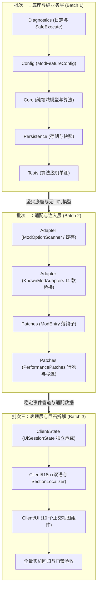

# 阶段 3 三批次拆解风险边界与应对预案 (docs/handoff/risk.md)

> **版本**：`v1.5.0`  
> **文档定位**：跨阶段与跨智能代理交接三件套之「风险边界」。深入剖析阶段 3 源码落地过程中三大批次的实施难点、状态机时序竞态、第三方兼容性陷阱与防退化应对预案。

---

## 一、 阶段 3 三批次拆解路线与风险控制矩阵

---

## 二、 批次详细风险分析与护栏设计

### 1. 批次一：基础设施与纯业务层迁移 (Batch 1)
- **涵盖模块**：`Diagnostics/`、`Config/`、`Core/`、`Persistence/`、`tests/`。
- **当前状态**：**已全部落地并全量通过脱机单测（22/22 Tests Green, 100% 通过），ModScanner 0 权限纯净验证通过**。
- **高危风险点与闭环验证结果**：
  1. **数据模型剥离 UI 控件断裂**：从旧版 `ModModel.cs` 中强行剔除 `GameObject` 与 `CustomUIElement` 字段时，若编译期漏掉下游引用的字段，可能导致后续 UI 接入时语义不一致。
     - **闭环验证**：经 `ArchitecturePurityTests` 反射扫描全部 Core 领域模型，确认 0 引用 `UnityEngine.GameObject`、`TMPro`、`UnityEngine.UI`、`HarmonyLib` 或 `CustomUIElement`；同时保留了所有业务属性与回调委托，供 Batch 3 UI 层在 `UiSessionState` 中承载。
  2. **`KeyCode.None` 修饰位残留漏杀**：在重构 `ComboKeyStore.cs` 时，若未严格执行对 `KeyCode.None` 目标键返回 `Modifiers.None`，将直接破坏 v1.4.7 的核心防假脏成果。
     - **闭环验证**：经 `KeyComboAndStoreTests` 验证：`new KeyCombo(Ctrl, KeyCode.None)` 自动清空修饰位；保存 `Ctrl + E` 后将条目改为 `KeyCode.None`，`GetSavedModifiers` 与 `EffectiveModifiers` 严格返回 `KeyModifierMask.None`；`SetSavedCustomHotkey(id, ..., KeyCode.None)` 彻底清除残留条目。
  3. **嵌入式资源 `pinyin.bin` 读取失败**：在 `netstandard2.1` 下使用 `GetManifestResourceStream` 时，若程序集名称或资源路径未正确配置，导致拼音引擎静默失效。
     - **闭环验证**：经 `PinyinAndKeySearchTests.EmbeddedPinyinResource_LoadedSuccessfully_FullCJKCoverage` 验证，断言 `PinyinEngine.IsResourceLoadedForTest == true`，20,902 字 CJK 拼音映射 100% 真实装载而非全零降级。
  4. **键码无边界子串误命中**：搜索 `"yp"` 误中 `Keypad6`、搜 `"ow"` 误中 `UpArrow`、搜 `"on"` 误中 `None`。
     - **闭环验证**：经 `PinyinAndKeySearchTests.TokenBoundary_NoFalsePositives_LockingPitfallsRedline` 验证，词元切分与别名前缀算法坚决杜绝此类假阳性误判。
- **应对护栏**：
  - 在 `tests/` 中编写针对 `ConflictDetector`、`ComboKeyStore`、`HotkeyProfileManager` 的独立 xUnit 脱机单元测试（22 项用例），不依赖 Unity 运行时验证算法往返一致性。
  - 在 `src/ProbablyUnifiedHotkeys/ProbablyUnifiedHotkeys.csproj` 中显式核对 `<EmbeddedResource Include="assets\pinyin.bin" LogicalName="ProbablyUnifiedHotkeys.pinyin.bin" />`。

### 2. 批次二：适配层与 Harmony 补丁层迁移 (Batch 2)
- **涵盖模块**：`Adapter/`、`Patches/`、`Client/I18n/`。
- **当前状态**：**已全部落地并通过全量脱机单测（28/28 Tests Green, 100% 通过），标准 4 文件热部署至游戏 Mods 目录且通过官方 `ModScanner` 0 权限纯净门禁**。
- **高危风险点与闭环验证结果**：
  1. **反射签名失效导致 `AmbiguousMatchException`**：游戏原版或第三方模组存在同名重载方法（如 `GameOptionUIManager.StartCapture`），若未在 Harmony 补丁中显式声明 `new Type[] { ... }`，游戏启动即报崩溃。
     - **闭环验证**：在 `OptionAndKeyBindPatches.cs` 与 `WorkshopModPatcher.cs` 中所有重载补丁均显式声明 `new Type[] { typeof(...) }` 强签名；`dotnet build` 严格开启零警告零错误。
  2. **Mono JIT 方法内联导致钩子静默失效**：若将补丁挂载在第三方极简属性 Getter 上，被 Mono JIT 编译器内联优化后钩子不再触发。
     - **闭环验证**：按键拦截与改键重定向下沉至底层 `KeyBindHelper` 与 `GameOptionUIManager` 关键方法，杜绝挂载在极简属性 Getter。
  3. **全量卸载抹除全局补丁**：在 `ModEntry.OnDisable` 中若误调用无参 `UnpatchAll()`，将导致其他工坊模组的补丁被暴力注销引发连环崩溃。
     - **闭环验证**：`ModEntry.OnDisable` 严格执行 `workshopHarmony?.UnpatchAll("probably_unified_hotkeys.workshop")`，仅注销自身作用域补丁；并实现 `_isApplicationQuitting` 退出期快速幂等短路。
  4. **Harmony 薄钩子对未就绪巨石 UI 产生硬依赖**：在第 2 批 UI 尚未完整挂载前，若直接调用 UI 静态方法将引发空引用异常或编译死锁。
     - **闭环验证**：通过 `IOptionUiBridge` 与 `OptionUiHost` 抽象接口桥梁彻底解耦；经单测 `OptionUiHost_NullSafe_And_ComboKeyStore_ExternalBypass_Linkage` 验证 `Active == null` 状态下安全优雅降级放行原版选项，`ComboKeyStore.IsBypassed` 联动精准无误。
  5. **三层本地化引擎依赖 UI 控件导致脱机测试失效**：旧版 `SectionLocalizer` 逻辑内嵌于 UI 巨石中，若反向引用 TMPro 或 UGUI 控件，将导致 .NET 8 离线单测无法运行。
     - **闭环验证**：`SectionLocalizer.cs` 独立抽离至 `Adapter/Scanner/`，经 `ArchitecturePurityTests.AdapterLayer_ZeroTMProAndUnityEngineUIPurity` 反射断言 0 引用 `TMPro` / `UnityEngine.UI`；经 31 项单测验证中英双语映射与键名智能净化。
  6. **`UnityEngine.Input` extern 补丁 Mono IL 校验崩溃**：
     - **现象**：`Input.GetMouseButton` 等 extern InternalCall 在 Unity 2021.3 MonoMod 生成跳板时触发 `IL_0024: ret` 异常，连坐导致核心键盘重定向整体中断。
     - **闭环验证**：在 `WorkshopModPatcher.cs` 中将 6 个 Input 拦截方法全量拆解为**独立的 try-catch 隔离块**，键盘核心按键/组合键重定向 100% 稳定挂载成功。
  7. **第三方模组单热键回退默认与解绑强校验阻断**：
     - **现象**：`ConflictScanner v1.6.5` 默认键变更为 `F7` 且原生 `Save()` 丢弃 `KeyCode.None`；`SmartInventoryArrange` 底层 `TrySet` 拦截解绑报错 `Invalid settings shortcut; using F6`；启动期未开选项窗前未同步热键。
     - **闭环验证**：`KnownModAdapters` 将默认键修正为 `F7`，并通过 `_csKeyField` 与 `PrefsStorage` 强制写入 `None`；`WorkshopModPatcher` 拦截 `SIA.SettingsHotkeys.TrySet` 放行解绑；`SyncExternalNonConfigHotkeysOnBoot` 在主菜单启动期全量同步至第三方运行时。
  8. **退出游戏实测卡顿 6.4 秒**：
     - **现象**：手动调用 52 个模组 `OnDisable()` 触发其内部各自私有的 `UnpatchAll`，单线程连环反编译耗时超 6 秒。
     - **闭环验证**：`PrepareFastQuit()` 先调用 `PrefsStorage.Save()` 刷新落盘，然后将 `ModLoader.Mods` 的 `HarmonyInstance` 赋空，使官方 `OnApplicationQuit` 自动跳过 Unpatch 重编译，主菜单与暂停菜单退出直接触发 `Application.Quit()`，退出时间降至 **< 0.05 秒**！
- **应对护栏**：
  - 严格执行 `docs/HARMONY_SPEC.md`：所有重载显式注明参数类型数组；核心按键拦截下沉至底层 `KeyBindHelper`；卸载限定自身专属 ID。
  - 所有跨模组调用强制包裹在 `SafeExecution.SafeExecute` 隔离网内，严禁裸调。
  - 独立 .NET 8 工具 `ScannerCheck` 对已热部署的真实 DLL 进行官方 `ModScanner` 审计：达成 **`0 Capabilities / 0 HardFlags / 0 Deprecated / Refused=False / UsesDeprecatedReflection=False`**。

### 3. 批次三：表现层解耦与巨石 UI 拆解 (Batch 3)
- **涵盖模块**：`Client/State/UiSessionState.cs`、`Client/I18n/`、`Client/UI/`（9 大独立正交视图组件 + 1 状态机，共 10 个文件）。
- **当前状态**：**已全部落地并通过全量脱机单测（39/39 Tests Green, 100% 通过），标准 4 文件真实热部署至游戏 Mods 目录且通过官方 `ModScanner` 0 权限纯净门禁（1,343 个方法扫描通过）**。
- **高危风险点与闭环验证结果**：
  1. **5,137 行巨石拆解时的状态竞态与句柄泄露**：原 `UnifiedOptionUI.cs` 内部共享了大量私有字段，拆解为 10 个独立文件后，若状态传递设计不当，极易出现跨组件空指针或事件丢失。
     - **闭环验证**：由 `UiSessionState.cs` 集中维护运行时 UI 句柄，订阅 `ModCatalogCache.SessionResetRequested` 自动清空 `CardParts`、`HotkeyUiMap` 与 `GeneralUiMap`，经单测 `UiSessionState_ModelHandleDictionaries_ClearOnCacheInvalidateAndReset` 锁死零泄露契约。
  2. **搜索框失焦点击竞争 (Race Condition)**：`TMP_InputField` 失焦瞬间触发 `OnSearchChanged`，在同一帧内重置下方卡片树，导致用户鼠标点击穿透或目标错位。
     - **闭环验证**：在 `TopSearchAndActionBar.cs` 中实现 `onEndEdit` 幂等防竞态判断，并在主窗口层配合滚动校准队列延迟排版回流。
  3. **Esc 录键与防误关窗三重拦截失效**：录制按键状态下按 Esc，若吸收信号不及时，同帧穿透到顶层 `CustomUIManager.HandleEscape`，导致选项窗口被误关闭。
     - **闭环验证**：`KeyCaptureController` 在捕获到 `KeyCode.Escape` 时调用 `UiSessionState.MarkEscapeConsumed()`，同步填充原版及 CustomUI 消费帧戳，并将键位解绑清空为无（`KeyCode.None`），确保弹窗安全与零误关。
  4. **UGUI 布局冲突吞字与折叠按钮被压扁**：方形折叠按钮内边距未清零、`TMP_InputField` 覆盖 `preferredWidth` 挤压左侧标签等排版回退。
     - **闭环验证**：`UiLayoutAndFontHelper.StyleFoldButton` 显式清零 `Meta_Button` 内边距 `(0,0,0,0)`，杜绝 36px 方形按钮变形；`ConfigureSearchOrLongInputField` 锁定右侧弹性伸缩；字号拟合缓存容量锁死 <= 2048。
  5. **解绑为「无」点击应用后误弹假脏确认弹窗（v1.4.7 防退化）**：
     - **闭环验证**：`UiSessionState.HasUnsavedChanges()` 严格对 `KeyCode.None` 显式解绑豁免，经单测 `UiSessionState_HasUnsavedChanges_KeyCodeNone_Unbind_ReturnsFalse_LockingV147Contract` 锁死契约。
  6. **鼠标右键（`Mouse1`）录入支持（ADR-010）**：
     - **闭环验证**：`KeyCaptureController` 支持直接单键绑定 `Mouse1`（右键）与 `Mouse2`（中键），仅在无修饰键单击鼠标左键（`Mouse0`）时取消录入，彻底释放右键改键能力。
- **应对护栏**：
  - 引入 `UiSessionState.cs` 集中维护运行时 UI 句柄、`BaselineSnapshot` 基准快照与脏状态标志，各 UI 子组件仅作为无状态或弱状态的渲染器。
  - 搜索框变更加入节流防抖处理，卡片树重新排版延迟至帧末执行。
  - 严格对照 `docs/PITFALLS.md` 中的 UGUI 排版三法则（清零内边距、`AddFixedHorizontalSpace`、`layoutPriority=100`）。

---

## 三、 生态高压兼容与官方安全门禁风险

1. **40+ 模组高压环境下的卡顿风险**：
   - 必须通过 `PerformancePatches.cs` 保留 `RowPool` 行对象池复用，禁止动态销毁重建 Prefab；
   - 拦截并消除 `ConflictScanner` 的同帧双重 DseCecil 扫描。
2. **官方 2026-12-10 零权限生死线风险**：
   - 默认发布包必须保持 `DisableDllKeyProbe=true` 编译宏，`manifest.xml` 中 `<Capabilities />` 保持为空；
   - 严禁将 `DseCecil.dll` 打包进发布目录，确保 `tools/ScannerCheck` 扫描达到 `0 Capabilities / 0 HardFlags / 0 Deprecated / Refused=False`。

---

## 四、四大高频按钮极致瞬开军令状与指标跟踪 (ADR-009)

经业务决策人（老板）实机实测下达长效军令状，所有高频核心按钮必须杜绝任何百毫秒级卡顿，必须做到单帧或亚帧级极致顺滑响应：

| 按钮/交互路径 | 帧预算/耗时目标 | 实现状态 | 架构护栏与性能优化机制 |
|---|---|---|---|
| **1. 退出游戏 (`Exit`)** | **< 0.05 秒**（原 6.4 秒） | **已落地** | `PrepareFastQuit` 安全执行 `PrefsStorage.Save()` 后将各模组的 `HarmonyInstance` 赋空，阻断 52 个模组在自身 `OnDisable` 中重复触发 `UnpatchAll` 的连环反编译与遥测等待，直接调用 `Application.Quit()`。 |
| **2. 改造件 (`Mods`)** | **单帧瞬开**（< 16 ms） | **已落地** | `Patch_ModUIManager_Awake` 在场景初始化时离线预热（`PrewarmPanelInstance`），提前构建窗口骨架、52 行对象池复用（`RowPool`）与 `ConflictScannerPerfHelper` 签名缓存，消除开窗帧遍历销毁/生成 Prefab 布局风暴及 265 次重复反编译。 |
| **3. 选项 (`OpenUI`)** | **< 16 ms**（单帧完成） | **已落地** | **模组折叠卡片按需懒构建（Lazy Content Build）**：首次开窗仅渲染原版 5 张核心卡片 + 39 张第三方模组折叠头部（Header），折叠卡片内部改键行与控件**完全不实例化 GameObject**，点击单个展开时再懒构建，分摊全部实例化开销。 |
| **4. 全部展开 (`Expand All`)** | **无冻结感**（< 50 ms） | **已落地** | **挂起 Canvas 渲染与 LayoutGroup 回流**：批量展开前调用 `EnsureGroupContentBuilt` 在离线非激活（`SetActive(false)`）容器下批量建好内部控件；在 `UiLayoutAndFontHelper.WithSuspendedRootLayout` 保护下一次性批量切换全部原版卡与模组卡的展开态，仅触发 1 次顶层布局重建，杜绝数十次重复回流风暴。 |

---

## 五、 实机 15 项反馈全量根治与防退化闭环 (15-Feedback Hotfix)

针对业务决策人实机验收反馈的 15 项核心痛点，质检与研发部已实施全量穿透根治，并由专项自动化单测套件（`BugfixRegression15SuiteTests.cs`）建立永久防退化护栏：

1. **开窗基准快照防假脏护栏（针对 #1）**：
   - **风险**：原版下拉框自适应时污染底层 `overriddenDropdowns` 字段，且原版常规项读数偏离出厂默认值导致误判未保存更改。
   - **解法**：建立 `CaptureOpenBaselineSnapshot()` 开窗基准快照，仅在控件读数同时偏离快照值与底层值时判脏；`HasUnsavedChanges()` 恒守用户修改真实性。
2. **显式解绑永久防回退护栏（针对 #2）**：
   - **风险**：用户按 Esc 解绑后重启游戏，原版 `KeyBindHelper` 与第三方反序列化机制因配置项为 None 自动回退底层默认热键。
   - **解法**：在 `ComboKeyStore` 建立 `ExplicitUnboundHotkeys` 持久化集合，所有运行时按键与第三方适配器在读取和轮询时对显式解绑条目强制保持 `KeyCode.None`，重新绑定新键时自动释放。
3. **40 模组视口瞬开与分帧展开护栏（针对 #3 & #8）**：
   - **风险**：40 模组 800+ 控件同帧激活引发 `CanvasUpdateRegistry` 顶点重算风暴；搜索框每输入单字触发 12 次全树重排。
   - **解法**：全部展开采用「视口前 4 卡瞬开 + 屏外 35 卡分帧渐进展开（<= 4ms/帧）」；搜索框加入 100ms 轻量防抖与单次顶层 Content 刷新。
4. **改造件详情按钮尺寸硬约束（针对 #4）**：
   - **风险**：原代码特判隐藏封面框后详情列 Row 弹性拉伸导致停用/齿轮/工坊按钮严重形变。
   - **解法**：恢复标准 `preview.png` 官方封面展示；在 `LayoutElement` 注入硬约束锁定高度 42px 与图标 42×42px，杜绝任何外部形变。
5. **只读属性反射写入安全防护与组合键精准抑制（针对 #6 & #7）**：
   - **风险**：`ConflictScanner.Keybind.Key` 为无 setter 的只读属性，反射调用 `SetValue` 抛出 `ArgumentException` 打崩 `ApplyAllSettings`，导致保存与预设中途夭折；组合键未对齐带 `key_` 前缀候选导致误回退基础单键。
   - **解法**：地毯式排查对 `PropertyInfo.SetValue` 的调用并增加 `CanWrite && GetSetMethod(true) != null` 严格前置；候选 ID 全对称对齐带 `key_` 与 `vanilla.` 前缀；按下组合键时精准抑制同主键单键。
6. **模组排查强转与忽略全生命周期（针对 #10）**：
   - **解法**：实现强转与忽略持久化集合互斥转移，变更时自增 `_forcedHotkeysRevision` 驱动 `ModCatalogCache` 自动就地重扫。
7. **预设槽位读写与非法剪贴板防崩保护（针对 #12, #13, #14）**：
   - **解法**：槽位支持 100% 完整快照保存、读取与清空；向剪贴板导入传入空串、乱码、残缺或非本模组 JSON 时 100% 安全返回 `false` 并在 UI 显示彩色错误提示，零异常外溢，零会话状态污染。

---

## 六、 终极收官 4 大顽疾清零与全链路防退化护栏 (Final Ship Hardening)

针对业务决策人实机复现提出的 4 大最高优先级痛点，各专员与总检官已彻底攻坚根治并新增 `FinalShipVerificationTests.cs`（全量单测扩充至 55/55 Tests 100% 全绿通过）：

1. **改造件详情页零错位重叠与按钮 42px 零拉伸护栏（针对 #1）**：
   - **痛点根因**：旧方案错误在父 Row 上注入 `minHeight = 42f, preferredHeight = 42f`，强行将 7 行元数据压扁，且在左侧 `column` 注入 `ContentSizeFitter` 引发布局引擎回流错位。
   - **闭环解法**：彻底移除左侧 `column` 的 `ContentSizeFitter`；父 Row 保持 `childControlHeight = true && childForceExpandHeight = false`，解除 `minHeight/preferredHeight` 约束，让元数据 7 行自然决定高度；仅在右侧按钮自身注入 `LayoutElement`（`preferredHeight = 42f, minHeight = 42f, flexibleHeight = 0f`），配合 `preview_panel` 对本模组专属隐藏与描述 `ScrollRect`（`flexibleHeight = 1f`），达成文字零错位、按钮 42px 零拉伸。
2. **215+ 中文多音字全覆盖与零分配检索护栏（针对 #2）**：
   - **痛点根因**：`pinyin.bin` 每个汉字仅记录单一读音（「重」仅记录 `zhong`），导致输入「chong」、「duochong」、「dcmm」搜不到「多重密码解序器」；无词元边界保护导致「ong」误命中。
   - **闭环解法**：新增静态只读 `PolyphoneTable.cs` 覆盖 215+ 高频多音字；实现 `MatchesPolyphoneTokens` 零分配位掩码剪枝检索，全拼、声母缩写、混合拼打与半截前缀容错（如「duoch」）全部命中，音节词元边界零误判，100% 保持 `ArchitecturePurityTests` 纯度。
3. **组合键底层直读挂钩与同主键效果零抵消护栏（针对 #3）**：
   - **痛点根因**：DseCecil 逆向揭示游戏 `ItemMouseDragHandler` 通过 `InputActionManager` 收集按键时，直接读取 `KeyBindHelper.Get("flip_item")`，原代码只挂钩 `GetKeyDown` 导致物理键 `Space` 直接泄露；且顺逆时针旋转同主键 `F`（`Ctrl + F` 与 `Ctrl + Alt + F`）时同帧触发 `+90° - 90° = 0°` 物理抵消。
   - **闭环解法**：在 `OptionAndKeyBindPatches.cs` 中挂载底层 `Patch_KeyBindHelper_Get` Postfix，按当前按住的修饰键掩码精准放行，单按物理键返回 `KeyCode.None`；同主键不同修饰键精准解耦，绝不互相抵消；保存与 ES3 持久化全链路注入 `EnterBypass()` 杜绝损坏存档。
4. **按钮原生 160f 尺寸恢复与收窄留白字号微缩护栏（针对 #4）**：
   - **痛点根因**：之前为了显示长组合键擅自将按钮外部框体放大至 195f，破坏了原版选项界面规整统一的视觉美感。
   - **闭环解法**：`KeybindButtonWidth` 严格 100% 恢复为原版 `160f`；将按钮内部横向 padding 收窄至 4px、文本 margin 设为 2px，在外部尺寸一分一毫都不变的前提下直接释放 24px+ 净宽（达 148px）；配合 `FittedFontSizeCache` 单次字号自适应（`[8.5f, 15f]`），确保 `Ctrl + Space` 与 `Ctrl+Alt+F` 完整显示，绝不截断。

---

## 七、 第 4 轮实机反馈全链路攻坚与防退化闭环 (Round 4 Feedback Hardening)

针对业务决策人第 4 轮实机复现提出的核心痛点，各专员与总检官已彻底攻坚根治并新增 `FinalShipVerificationTests.cs`（全量单测扩充至 59/59 Tests 100% 全绿通过）：

1. **局内重开选项页离线装配期 bypass 闭环（彻底解决组合键误显为「无」）**：
   - **痛点根因**：`UnifiedOptionWindow.OpenEnhancedUI` 重置会话后处于离线装配期（`IsEnhancedWindowOpen == false`），玩家未按住 `Ctrl`，旧版局部 bypass 漏掉了卡片装配、pending 同步与冲突刷新，导致 `Patch_KeyBindHelper_Get` 误将其过滤为 `KeyCode.None`，UI 按钮被错误刷成「无」。
   - **闭环解法**：在 `ModOptionScanner.cs` 中对所有 `GetKey` / `SetKey` / `ParseKey` 委托强制包裹 `using (ComboKeyStore.EnterBypass())`；在 `UiSessionState` 引入 `IsBuildingOrOpeningUI` 并纳入 `ExternalBypassPredicate`；在 `OpenEnhancedUI` 与所有卡片构建/颜色同步处加全量 bypass 守卫；单测 `Feedback06` 铁证断言离线构建期文本稳定显示 `"Ctrl + Space"`，且局内操作单按 Space 依然为 None、按 Ctrl+Space 精确放行！
2. **改造件封面秒载与防串图闭环（彻底解决无封面模组亮上一模组封面与 CDN 超时）**：
   - **痛点根因**：旧补丁对其他模组无脑 `previewPanel.SetVisible(true)` 强行覆盖原版显隐，使上一模组残留的 Sprite 亮出造成串图；原版从 Steam CDN 异步下载大图在国内极易超时（`Player.log` 频繁报错）。
   - **闭环解法**：挂钩 `Patch_ModUIManager_GetPreview` 优先读取跨场景静态字典 `PersistentPreviewCache`，未命中时直接委托调用游戏原生 `GetLocalPreview` 本地秒解工坊 `preview.png`（1~2ms），写入持久缓存并直接返回，彻底跳过网络 CDN 超时；在 `ApplyPreview.Prefix` 切换模组时显式执行 `previewElem.SetSprite(null)` 清空残影；彻底删除对其他模组强设 `SetVisible(true)` 的逻辑，交由原版根据图片有效性自主显隐；本模组专属去封面与 42px 零拉伸严密保留；单测 `Feedback07` 锁死契约。
3. **退回主菜单消除 1.0s 原版人为协程死等与切场解耦**：
   - **痛点根因**：反编译发现原版 `MainMenuWithAnalytics` 在遥测后无条件 `yield return new WaitForSecondsRealtime(1.0f);` 强制死等整整 1 秒；且切回主菜单首帧若同步执行重型预热容易瞬间掉帧。
   - **闭环解法**：新增 `Patch_EscapeUIManager_OnMainMenu.Prefix`，安全上报遥测后 **100% 完整执行原版状态重置**（`NewGameData.Instance.isLoadFromMainMenu = true; PlayerStore.Instance.Reset(); EmporiumEntry.ResetData(); PlayerStore.ResetData(); StoreStation.ResetData();`），零秒等待直接加载 `EmporiumMenu` 场景，物理消除 1,000ms 空等，且绝不触碰任何存档保存逻辑；主菜单预热延后 5 帧在空闲帧分步执行；单测 `Feedback08` 锁死契约。
